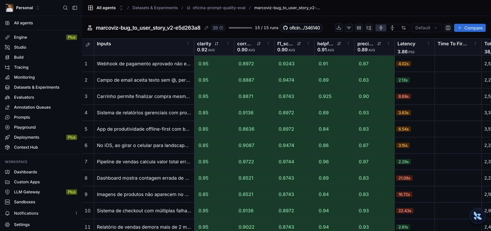
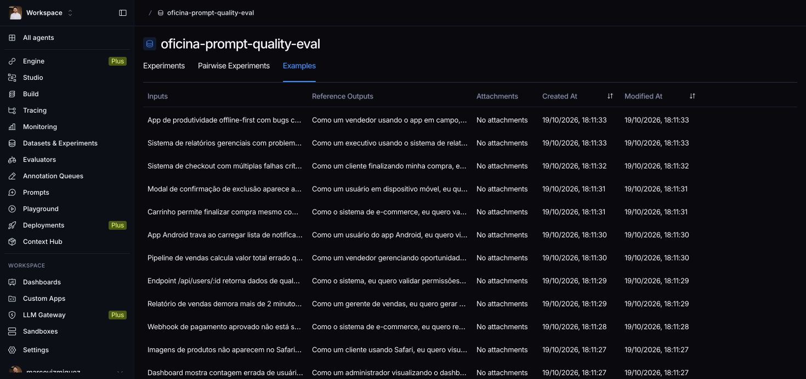

# Oficina de qualidade de prompts

Pipeline para converter relatos de bugs em User Stories, publicar uma versão do prompt no LangSmith e medir a qualidade em um dataset fixo de 15 exemplos. A implementação mantém o avaliador e o dataset fornecidos pelo exercício.

## Técnicas Aplicadas (Fase 2)

O prompt `prompts/bug_to_user_story_v2.yml` combina três técnicas:

| Técnica | Aplicação | Motivo |
|---|---|---|
| Few-shot | Três pares entrada/saída: filtro de exportação, duplicação de endereço com perda do CEP e relato insuficiente | Demonstrar cobertura de múltiplos defeitos, critérios verificáveis e tratamento de lacunas sem fabricar requisitos |
| Role prompting | Product Manager responsável por histórias implementáveis e testáveis | Relacionar o comportamento esperado a um plano técnico, distinguindo fatos do relato e propostas de solução |
| Skeleton of thought | Seções fixas de título, contexto, User Story, critérios de aceitação, plano técnico proposto e pontos a esclarecer | Dar uma estrutura consistente à resposta final, sem solicitar raciocínio interno |

O exemplo de CSV preserva o filtro da profissional selecionada e verifica que outros horários não aparecem. O de endereço cobre clique único, cliques repetidos e preservação do CEP. Ambos incluem propostas de correção e testes, explicitamente separadas das causas ainda não confirmadas. O relato insuficiente pede atual, esperado e reprodução. O prompt também delimita o relato como dado e rejeita instruções que tentem mudar a tarefa.

### Comparação v1 e v2

A v1 presente no starter usa uma instrução genérica, insere `bug_report` nas mensagens de sistema e usuário, não fornece exemplos e não define critérios de aceitação. A v2 deixa a variável somente na mensagem do usuário, explicita o papel, fixa o formato, demonstra entradas/saídas e separa fatos de lacunas.

O pull real do Hub foi executado em 19/10/2026 pela função `pull_prompts_from_langsmith`, com leitura pública sem chave. O conteúdo importado confirma essa comparação e foi salvo no arquivo v1. As iterações empíricas da v2 estão descritas abaixo; esta comparação estrutural não atribui uma nota à v1. O identificador semente `leonanluppi/bug_to_user_story_v1` é obrigatório no exercício; os scripts preservam esse contrato.

### Iterações orientadas pelo feedback

As quatro versões abaixo foram publicadas como revisões de `marcoviz/bug_to_user_story_v2` em 19/10/2026 e tiveram suas avaliações concluídas sobre o mesmo dataset de 15 exemplos. Os identificadores são commits do prompt no LangSmith.

| Iteração | Commit do prompt | Modelo de geração e avaliação | Amostragem |
|---|---|---|---|
| 1 | `f656413b` | `gemini-3.5-flash-lite` | O SDK informou que o modelo ignora `temperature=0` e usa seus padrões fixos |
| 2 | `9a8c8a89` | `gemini-3.1-flash-lite` | Aceita o `temperature=0` configurado pelo avaliador |
| 3 | `ef57c60f` | `gemini-3.1-flash-lite` | Mesma configuração da iteração 2 |
| 4 | `70d13a64` | `gemini-3.1-flash-lite` | Mesma configuração das iterações 2 e 3 |

1. **Estrutura e critérios verificáveis.** A primeira versão combinou papel, formato e três exemplos. A análise de uma saída identificou omissão de três dos quatro problemas de um relato composto. Esse feedback motivou instruções explícitas para cobrir todos os problemas, preservar os fatos técnicos fornecidos e conferir a correspondência entre entrada e critérios de aceitação. A execução terminou com código de saída 0 e as cinco métricas agregadas atingiram o limite mínimo de 0,8. A continuidade com `gemini-3.1-flash-lite` permite respeitar o `temperature=0` do avaliador, ignorado pelo modelo da primeira execução.
2. **Cobertura integral do relato.** A segunda versão acrescentou essas instruções e tornou o exemplo de endereço um caso com dois defeitos: duplicação e perda do CEP. A saída analisada passou a cobrir todos os problemas, mas ainda faltava um plano técnico suficiente para orientar a implementação. Essa observação é qualitativa e não substitui as métricas agregadas.
3. **Propostas técnicas e testes.** A terceira versão incluiu a seção “Plano técnico proposto”, com diagnóstico, mecanismo de correção, efeito esperado e testes. Os exemplos passaram a demonstrar propostas de filtro compartilhado, idempotência e verificação do percurso do CEP. Soluções sugeridas são identificadas como propostas, sem apresentá-las como causas comprovadas ou requisitos já aprovados. As médias desta revisão atingiram os limites numéricos, mas um erro 429 do juiz de F1 comprometeu essa execução como evidência final; o registro foi preservado e está explicado abaixo.
4. **Relato curto também pode ser suficiente.** Outro feedback da iteração 2 mostrou uma recusa indevida diante de um relato com defeito identificável. A quarta versão diferencia brevidade de ausência de informação: quando há elemento ou ação identificável e um defeito, exige User Story e critérios mínimos observáveis, deixando detalhes faltantes como perguntas complementares. A recusa fica limitada a relatos sem qualquer elemento, ação ou defeito identificável, como “não funciona”. Esta é a revisão final: as cinco métricas agregadas superaram 0,8, sem erros de geração ou dos avaliadores.

A passagem de **1 para 2 mudou o prompt e o modelo**, portanto não permite atribuir eventual diferença de nota somente ao prompt. As comparações de **2 para 3 e de 3 para 4 mantêm modelo, configuração de temperatura, dataset e avaliador**, isolando melhor as alterações do prompt. Ainda assim, métricas produzidas por um avaliador LLM podem variar entre execuções.

## Como Executar

Pré-requisitos: Python 3.12, conta LangSmith com chave e handle público, e chave do Gemini (ou OpenAI, suportado pelo avaliador original).

```bash
python3 -m venv .venv
source .venv/bin/activate
pip install -r requirements.txt
cp .env.example .env
```

Configure no `.env`:

- `LANGSMITH_API_KEY`, seu próprio `USERNAME_LANGSMITH_HUB` e `LANGSMITH_PROJECT=oficina-prompt-quality`. As evidências deste repositório usam o handle público `marcoviz`.
- `LLM_PROVIDER=google`, `GOOGLE_API_KEY`, `LLM_MODEL=gemini-3.1-flash-lite` e `EVAL_MODEL=gemini-3.1-flash-lite`, configuração usada nas iterações 2, 3 e 4 e compatível com `temperature=0`.
- Para OpenAI, use `LLM_PROVIDER=openai` e `OPENAI_API_KEY`; altere também **`LLM_MODEL` e `EVAL_MODEL`** para nomes de modelos OpenAI disponíveis na sua conta e compatíveis com `temperature=0`. Não mantenha os nomes Gemini do `.env.example` ao trocar o provider. As evidências publicadas acima correspondem ao Gemini; trocar provider ou modelos exige uma nova avaliação para medir os resultados dessa configuração.

Consulte os [modelos Gemini](https://ai.google.dev/gemini-api/docs/models) ou [modelos OpenAI](https://platform.openai.com/docs/models). Não envie o `.env` ao repositório.

Execute na raiz, nesta ordem:

```bash
python src/pull_prompts.py
python src/push_prompts.py
python src/evaluate.py
```

O pull importa o prompt semente como `ChatPromptTemplate` e salva a v1 sem descartar mensagens. Se o formato remoto não corresponder ao suportado, falha explicitamente. O push valida o YAML, exige `few-shot` e outra técnica, confere a variável `bug_report` e publica `HANDLE/bug_to_user_story_v2` como prompt público.

O avaliador busca a versão publicada, executa os 15 exemplos e registra o experimento com tracing. Confira **helpfulness, correctness, f1_score, clarity e precision**, além da média. Todas precisam atingir **0,8**; uma média alta não compensa uma métrica abaixo do limite.

Analise os exemplos com falhas, ajuste somente o prompt, faça novo push e repita a avaliação. O exercício espera 3 a 5 iterações; registre somente as efetivamente realizadas. `src/evaluate.py`, `src/metrics.py`, `src/utils.py` e o dataset permanecem inalterados.

## Resultados Finais

A **iteração 4**, commit `70d13a64`, atingiu o critério da avaliação automática em **19/10/2026**: 15/15 exemplos processados, cinco feedbacks por exemplo e nenhum erro de geração ou dos avaliadores. O modelo de geração e o juiz foram `gemini-3.1-flash-lite`, com `temperature=0`. A média geral foi **0,9031**, e todas as cinco métricas ficaram acima de **0,8**.

As notas abaixo são **médias agregadas por métrica sobre os 15 exemplos**. Elas não significam que cada exemplo individual tenha alcançado 0,8 em todas as métricas. A média geral é a média das cinco métricas; o aceite exige conferir cada uma separadamente.

| Métrica | Iteração 1 | Iteração 2 | Iteração 3 | Iteração 4 | Critério |
|---|---|---|---|---|---|
| helpfulness | 0,8950 | 0,8580 | 0,8950 | 0,9063 | ≥0,8 |
| correctness | 0,8541 | 0,8045 | 0,8506 | 0,8953 | ≥0,8 |
| f1_score | 0,8188 | 0,7830 | 0,8313 | 0,9012 | ≥0,8 |
| clarity | 0,9007 | 0,8900 | 0,9200 | 0,9233 | ≥0,8 |
| precision | 0,8893 | 0,8260 | 0,8700 | 0,8893 | ≥0,8 |
| Média | 0,8716 | 0,8323 | 0,8734 | 0,9031 | Não substitui os cinco critérios individuais |
| Resultado | Limites atingidos; temperatura ignorada pelo modelo | Reprovada: F1 abaixo de 0,8 | Limites numéricos atingidos; erro de juiz | Aprovada nas cinco médias; execução final válida | Todas as cinco médias ≥0,8 |

A iteração 1 terminou com código de saída 0 e as cinco métricas no limite exigido, mas o `gemini-3.5-flash-lite` ignorou a temperatura configurada. As execuções seguintes usaram o modelo compatível com essa configuração. A iteração 2 concluiu os 15 exemplos e reprovou apenas em F1.

Na iteração 3, uma avaliação de F1 recebeu **429 RESOURCE_EXHAUSTED**. O avaliador original registrou **0** nesse feedback e a execução terminou com as médias mostradas acima. Esse zero continua nos dados e no cálculo; não foi removido, substituído nem reclassificado. Como houve falha do juiz, essa rodada **não é usada como evidência final de qualidade**, apesar de atingir numericamente os limites. A iteração 4 concluiu os 75 feedbacks sem esse problema.

Os números, identificadores de experimentos e erros estão no [resumo exportado do LangSmith](evidence/summary.json). Os snapshots permitem recuperar o prompt exato de cada rodada:

| Iteração | Prompt avaliado | Log da execução | Resultados completos | Experimento |
|---|---|---|---|---|
| 1 | [YAML f656413b](evidence/prompt-iteration-01.yml) | [Log](evidence/iteration-01.log) | [JSON](evidence/iteration-01.json) | [LangSmith](https://smith.langchain.com/o/9456154d-20f9-4dab-9f76-3d41519461e6/datasets/c665eea4-95f0-4a7d-bd9b-f78b721a85fb/compare?selectedSessions=585222e6-0812-4a13-ac02-9051253b350b) |
| 2 | [YAML 9a8c8a89](evidence/prompt-iteration-02.yml) | [Log](evidence/iteration-02.log) | [JSON](evidence/iteration-02.json) | [LangSmith](https://smith.langchain.com/o/9456154d-20f9-4dab-9f76-3d41519461e6/datasets/c665eea4-95f0-4a7d-bd9b-f78b721a85fb/compare?selectedSessions=7fe02fd5-80f9-463a-ab7b-7588c9453f66) |
| 3 | [YAML ef57c60f](evidence/prompt-iteration-03.yml) | [Log](evidence/iteration-03.log) | [JSON](evidence/iteration-03.json) | [LangSmith](https://smith.langchain.com/o/9456154d-20f9-4dab-9f76-3d41519461e6/datasets/c665eea4-95f0-4a7d-bd9b-f78b721a85fb/compare?selectedSessions=f49898b3-a66c-463d-8526-be9b3f9d0cae) |
| 4 | [YAML 70d13a64](evidence/prompt-iteration-04.yml) | [Log](evidence/iteration-04.log) | [JSON](evidence/iteration-04.json) | [LangSmith](https://smith.langchain.com/o/9456154d-20f9-4dab-9f76-3d41519461e6/datasets/c665eea4-95f0-4a7d-bd9b-f78b721a85fb/compare?selectedSessions=3c29e829-f895-4700-bfd5-185197c5f010) |

## Evidências públicas

- [Prompt final — marcoviz/bug_to_user_story_v2, commit 70d13a64](https://smith.langchain.com/hub/marcoviz/bug_to_user_story_v2/70d13a64)
- [Dataset público com 15 exemplos e experimentos](https://smith.langchain.com/public/b4d329f4-aeb1-47ac-ac0f-b8e4ad3b8a1f/d)
- [Trace público — Relato curto](https://smith.langchain.com/public/15a89758-5725-4292-b3a3-0c3d9f3dc960/r) · [exportação JSON](evidence/trace-simple.json)
- [Trace público — Relato intermediário](https://smith.langchain.com/public/1b000e99-f9e8-471b-bec5-8fef7a4f945a/r) · [exportação JSON](evidence/trace-medium.json)
- [Trace público — Relato extenso](https://smith.langchain.com/public/c785d732-cb6e-4050-af36-75f1ce27ddb1/r) · [exportação JSON](evidence/trace-complex.json)

O dataset foi compartilhado uma vez. Os três traces foram escolhidos entre os resultados da iteração final por tamanho do relato: o menor, o intermediário e o maior. Os links diretos de experimento podem exigir acesso ao workspace; o dataset e os traces acima têm compartilhamento público.





## Validação local e arquivos preservados

Os **10 testes locais passaram em 0,12 s**, em 19/10/2026, após a revisão final. Eles cobrem campos e estrutura do YAML, few-shot, técnica adicional, uso de `bug_report`, formatação com chaves literais e preservação do prompt importado:

```bash
PYTHONPATH=src pytest -q
```

`src/evaluate.py`, `src/metrics.py`, `src/utils.py` e `datasets/bug_to_user_story.jsonl` foram comparados byte a byte com o repositório base e permanecem inalterados. Seus hashes SHA-256 estão em [`evidence/summary.json`](evidence/summary.json). Os testes locais verificam o pipeline; os experimentos e traces registram a qualidade medida com o modelo real.

A publicação dos prompts e dessas evidências no LangSmith não envia o repositório para avaliação na plataforma do curso. Esse envio é manual.
